# Lekora

**A native iPhone app for your [Hermes](https://github.com/NousResearch/hermes-agent) agents.**

Lekora gives the agents you already run on Hermes a proper home on your phone: a Messages-style list of your agents, live streaming chat, voice and calls, files, artifacts, a task board, and the controls Hermes normally hides behind a terminal. It sits on top of your existing Hermes. Nothing about your setup has to change, and Hermes is never made to open an API.

> **Status: alpha.** Lekora isn't on the App Store yet; for now you build the app yourself in Xcode ([steps below](#getting-started)). Foundation, a complete chat experience, files, voice and artifacts are finished and in daily use. The task board has just landed. See [STATUS.md](STATUS.md) for exactly what works today.

<p align="center">
  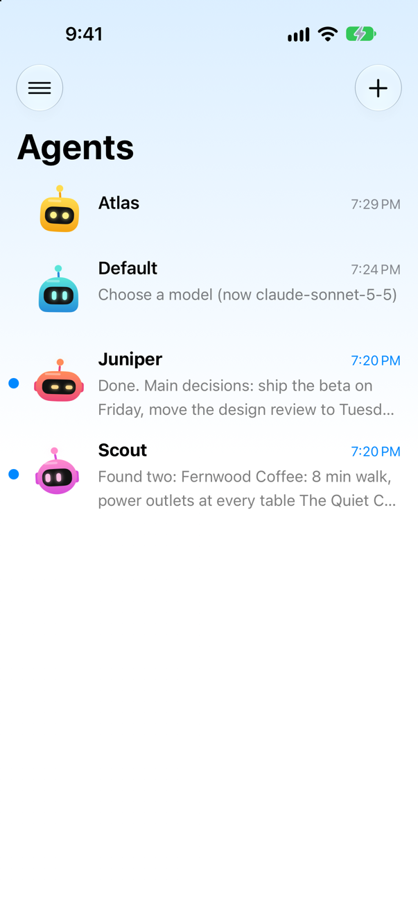
  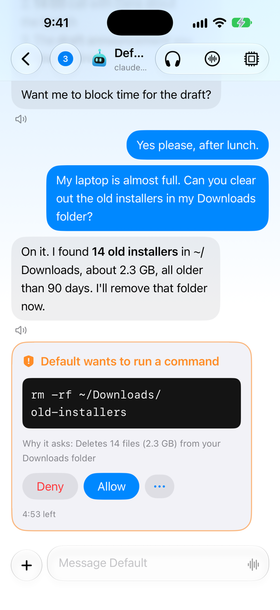
  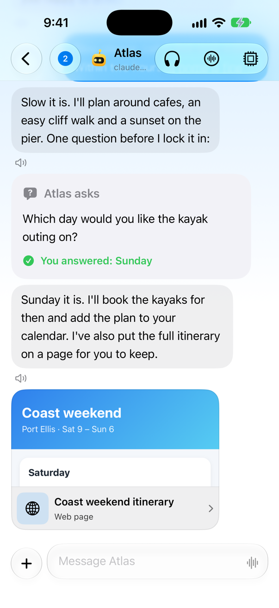
  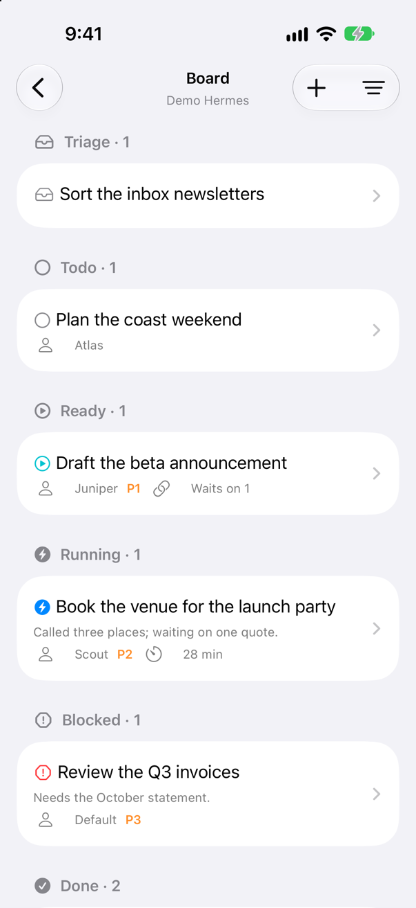
</p>

<sub>All screenshots in this README use a demo host with made-up agents and conversations (see <code>tools/demo_host.py</code>), so no real chats appear.</sub>

## Contents

- [How it works](#how-it-works)
- [Getting started](#getting-started)
- [Using Lekora](#using-lekora)
  - [Your agents](#your-agents)
  - [Chatting](#chatting)
  - [Approvals and questions](#approvals-and-questions)
  - [Slash commands](#slash-commands)
  - [Chat settings](#chat-settings)
  - [Choosing a model](#choosing-a-model)
  - [OpenRouter: advanced settings](#openrouter-advanced-settings)
  - [Voice notes, voice replies and calls](#voice-notes-voice-replies-and-calls)
  - [Files](#files)
  - [Artifacts](#artifacts)
  - [The task board](#the-task-board)
  - [Past chats and offline mode](#past-chats-and-offline-mode)
  - [Several Hermes instances](#several-hermes-instances)
- [Works anywhere Hermes does](#works-anywhere-hermes-does)
- [Coming next](#coming-next)
- [Repository](#repository)
- [License](#license)
- [Security and privacy](#security-and-privacy)

## How it works

Two pieces:

| Piece | Where | What it does |
|---|---|---|
| **Lekora plugin** | Your Hermes machine | Connects to Hermes natively, as a messaging platform (like Telegram or Slack). No dependencies. |
| **Lekora app** | Your iPhone | The interface. Requires iOS 26 or newer. |

The plugin install is the only technical step. Everything else happens in the app, once, in its setup screens. Your chats, files, artifacts and settings are kept on your Hermes machine, so a new phone picks up where the old one left off.

## Getting started

You need Hermes 0.22 or newer (below 1.0), and your phone and Hermes machine on the same Wi-Fi or the same Tailscale network.

**1. Install the plugin** on the machine that runs Hermes:

```bash
cp ~/.hermes/config.yaml ~/.hermes/config.yaml.pre-lekora && \
hermes plugins install howephillip/lekora#plugin/lekora --enable && \
hermes config set platforms.lekora.enabled true && \
hermes gateway restart && \
hermes lekora pair
```

This backs up your config first, changes only two clearly labelled settings, and prints a pairing QR code.

**2. Build the app** (alpha only; an App Store release will replace this). You need a Mac with Xcode 27 and an iPhone on iOS 26 or newer:

```bash
git clone https://github.com/howephillip/lekora.git
open lekora/app/Lekora.xcodeproj
```

In Xcode, select the Lekora target, set your own team under Signing & Capabilities, choose your iPhone, and press Run.

**3. Pair.** Open the app and scan the code (or tap the pairing link). Then tell Lekora what your agents should call you, and pick which agents to show.

<p align="center">
  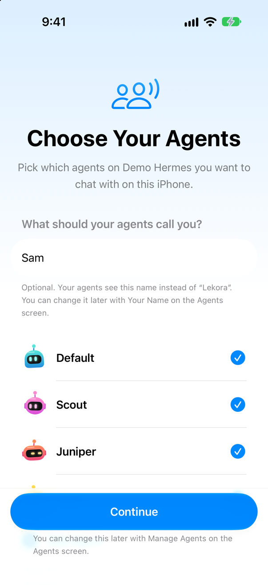
</p>

Full details, including removing phones and undoing the install, are in [docs/install.md](docs/install.md).

## Using Lekora

### Your agents

The home screen is a Messages-style list of every Hermes profile on your instance. Each agent has its own animated avatar, its last message, the time, and a blue dot when it has replies you haven't read. While an agent is working, its row shows what it's doing; when it's waiting on you, the row says so in orange. The most recent conversation is at the top.

The **menu button** (top left) opens a pane with the Board, your name, your Hermes instances and Manage Agents. The **+** adds an agent. In **Manage Agents** you choose which agents appear on this phone, add new ones (cloned from your default agent's settings), and delete them (swipe left; it asks first, keeps a backup, and never deletes `default`).

<p align="center">
  
  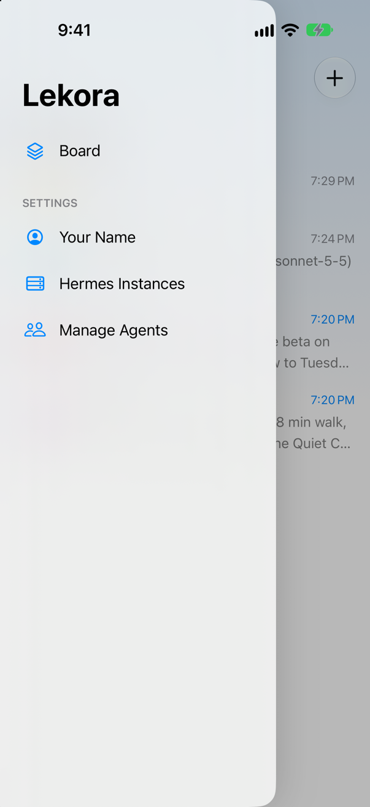
  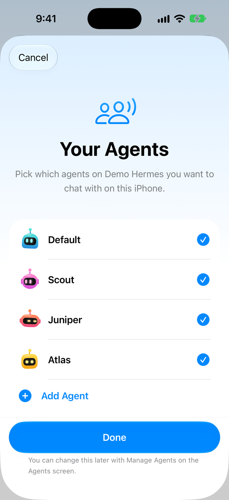
  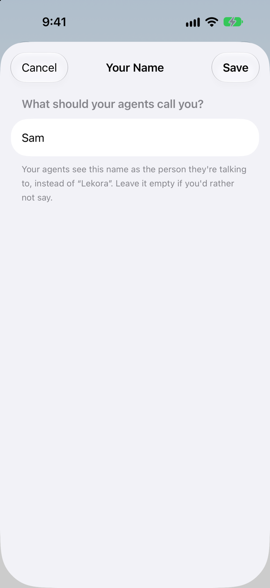
</p>

All agents are equal: every feature works for every profile. **Your Name** (in the menu) is what your agents call you instead of "Lekora".

### Chatting

Open an agent and talk, as in Messages. Replies **stream in word by word**, with a live "thinking" line ("Searching the web…") showing what the agent is doing. Hermes' own notices ("new session started") appear as small system lines. Drag the chat left to see the time of every message, and tap the ⌄ button to jump to the newest.

<p align="center">
  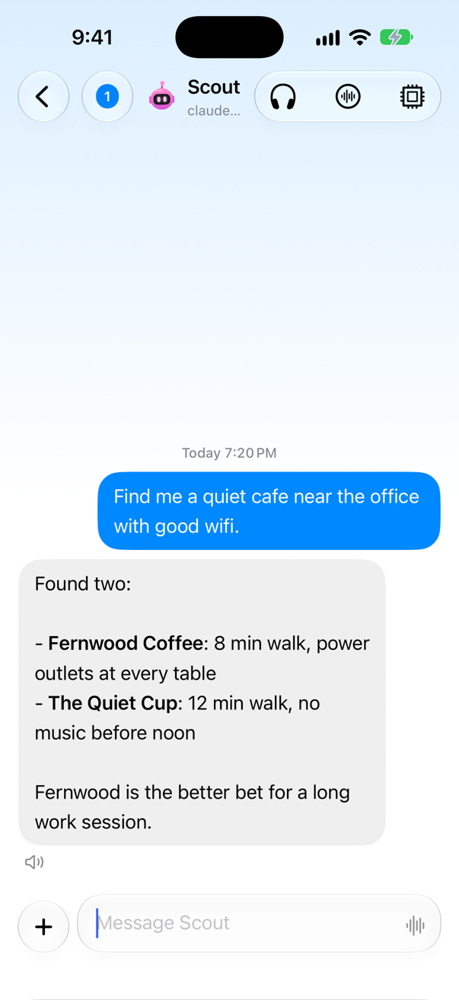
</p>

Across the top of a chat: the back button (with a count of other agents' unread replies), the agent's name and model (tap it for [chat settings](#chat-settings)), a **headphones** button to start a [call](#voice-notes-voice-replies-and-calls), a **waveform** button for voice replies, and a **chip** button for the [model picker](#choosing-a-model). The **+** next to the message box attaches [files and photos](#files).

### Approvals and questions

When an agent needs your permission or a decision, a card appears right in the conversation instead of a wall of text.

**Approvals.** When Hermes pauses an agent to ask before running something risky, you see exactly what it wants to run, why it's asking, and a countdown. **Deny** (optionally with a reason the agent sees) or **Allow**. The "…" button offers **Allow for This Chat** and **Always Allow** (which asks you to confirm first). Afterwards the card shows the outcome ("Allowed once", "Denied", "Timed out — nothing ran"), and the agent carries on.

<p align="center">
  
  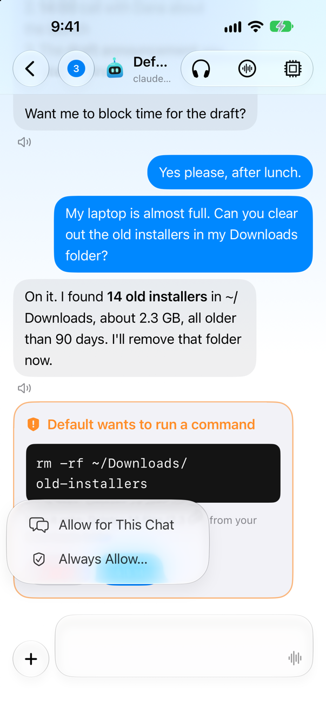
  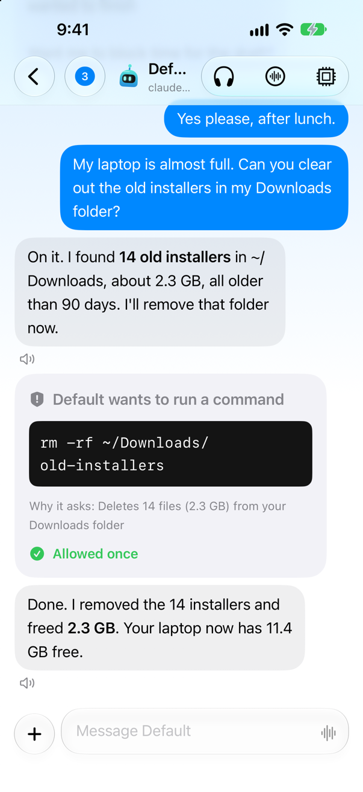
  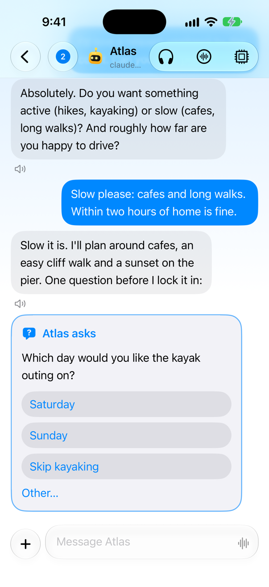
</p>

**Questions.** When an agent needs you to choose, you get a card with a button per option (or ticks, if you can pick several), **Other…** for your own answer, or an answer box for open questions. Answer once and the card records your choice; the agent carries on. Answers sync across your phones.

Hermes' other confirmations (for example `/new`) show up as cards too.

### Slash commands

Type `/` in the message bar and the agent's real commands appear above it with their descriptions: Hermes' built-in commands (in your language), your skills, plugin commands and your `quick_commands`. Keep typing to narrow the list. Commands with fixed options (`/reasoning`, `/approvals`) offer them next. Tap to fill the bar, then send.

<p align="center">
  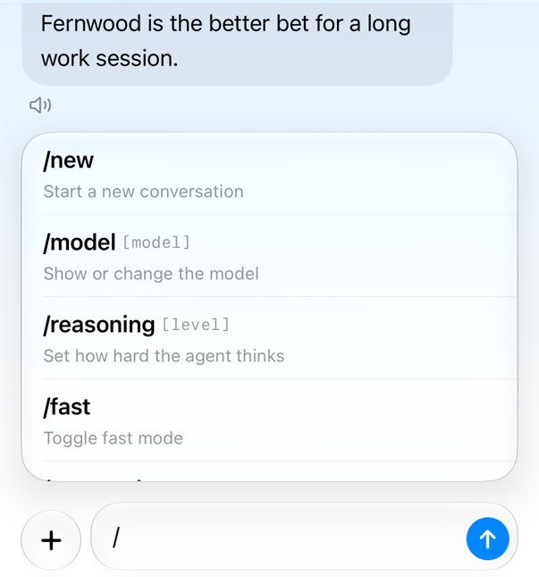
  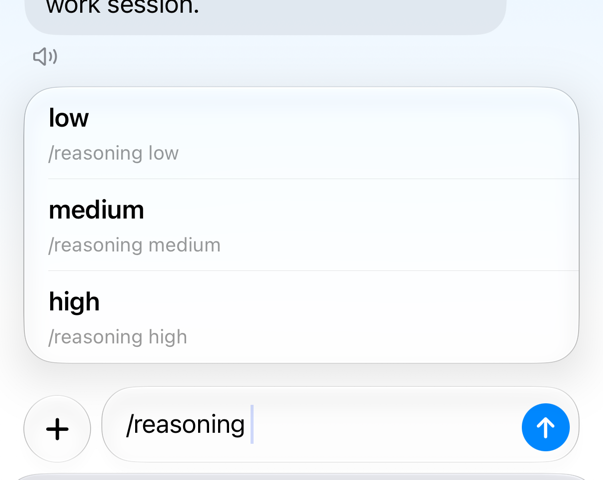
</p>

### Chat settings

Tap the agent's name at the top of a chat. **Chat Settings** shows what the chat is running on and lets you change it without typing commands.

<p align="center">
  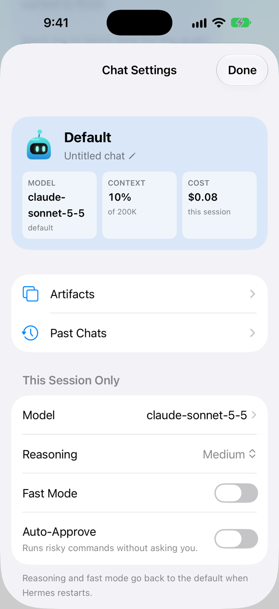
  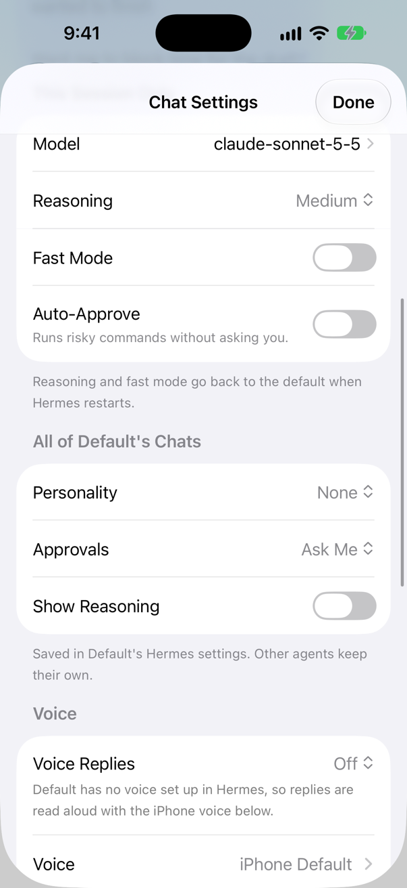
  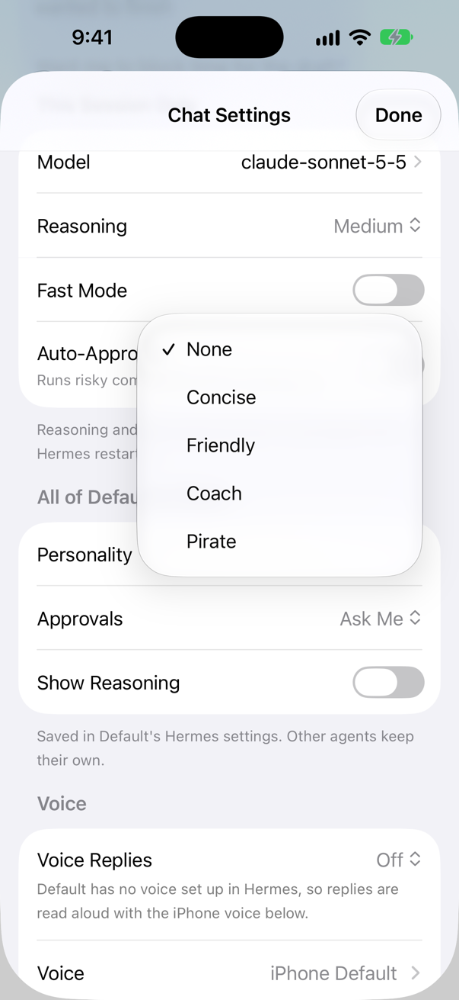
  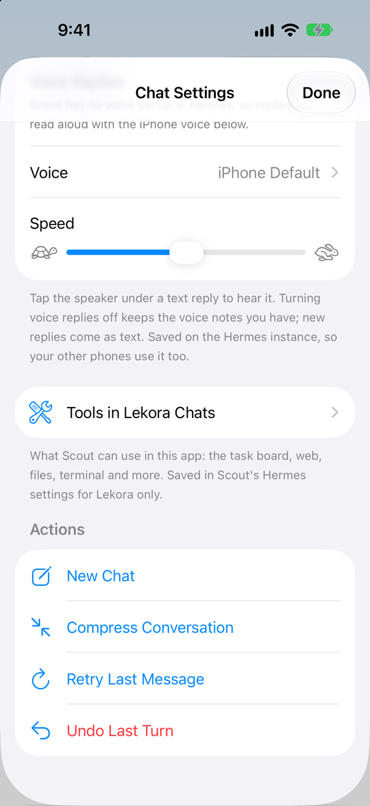
</p>

- **At a glance:** the model, how full the chat's memory (context) is, and what the chat has cost so far. Tap the chat's name to rename it.
- **This session only:** Model, Reasoning (Off to Extra High), Fast Mode and **Auto-Approve**. Auto-Approve asks you to confirm first, and a small amber **Auto** badge shows in the chat header while it's on.
- **All of an agent's chats:** Personality, Approvals (Ask Me, Smart, Never Ask) and Show Reasoning. These are saved in that agent's Hermes settings, so each agent keeps its own.
- **Voice:** replies off, to your voice notes, or always; the voice and its speed. See [Voice](#voice-notes-voice-replies-and-calls).
- **Tools in Lekora Chats:** every Hermes toolset, on or off for this agent's Lekora chats (the task board, web search, files, terminal…), or **Same as Telegram**. Lekora chats are their own Hermes platform, so this is where you give an agent the tools it should have here.
- **Actions:** New Chat, Compress Conversation, Retry Last Message, and Undo Last Turn. The destructive ones ask first.

<p align="center">
  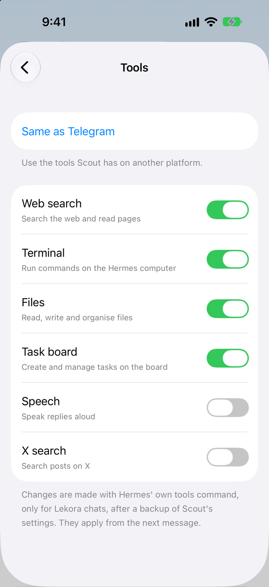
  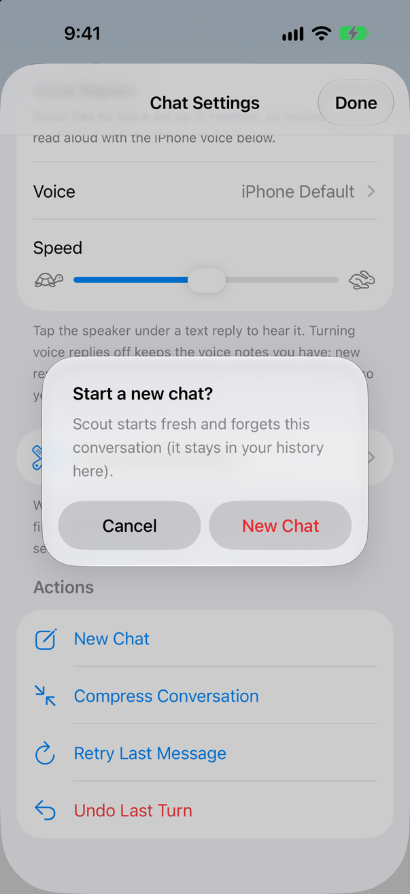
</p>

### Choosing a model

Tap the **chip** button in a chat (or type `/model`). A card shows the model the agent is using; **Choose a Model…** opens a searchable list of every model your Hermes can use, grouped by provider. Every model shows its **price** (per million tokens in and out), its context size, and badges for reasoning and image reading. Tap one and Hermes switches and confirms. If Hermes flags a model (for example, expensive), the app asks "Switch anyway?" first. `/reasoning` and `/fast` get a card with one button per option.

<p align="center">
  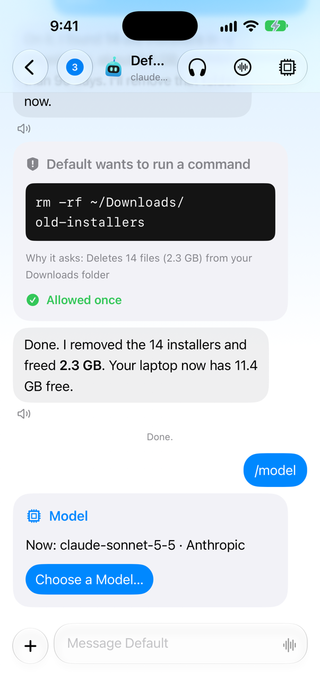
  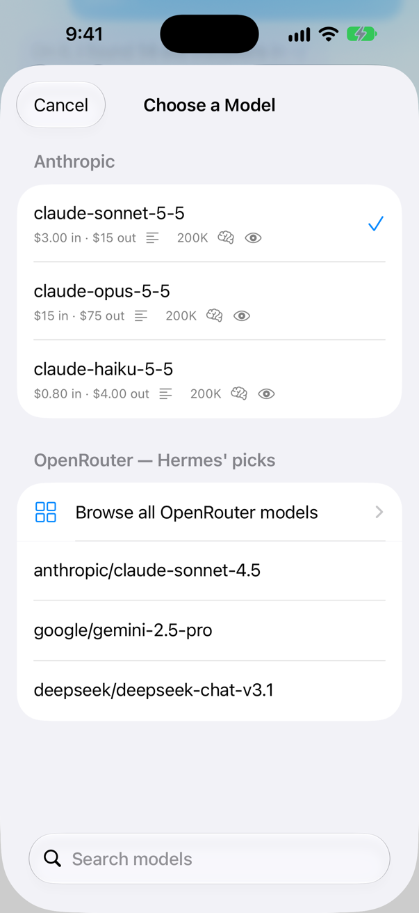
</p>

### OpenRouter: advanced settings

If you use OpenRouter, the picker has **Browse all OpenRouter models**: its whole catalogue of models that can use tools (hundreds), grouped by maker, with live prices. Search, sort (by maker, cheapest, newest, largest context) and filter (free, reasoning, reads images).

<p align="center">
  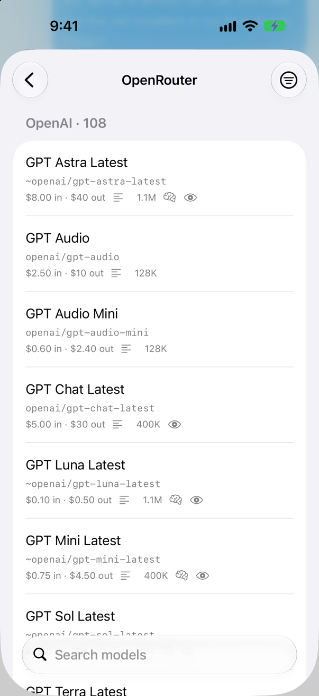
  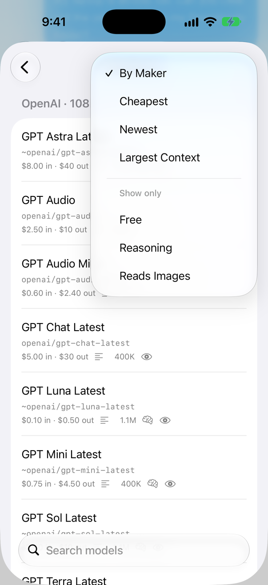
  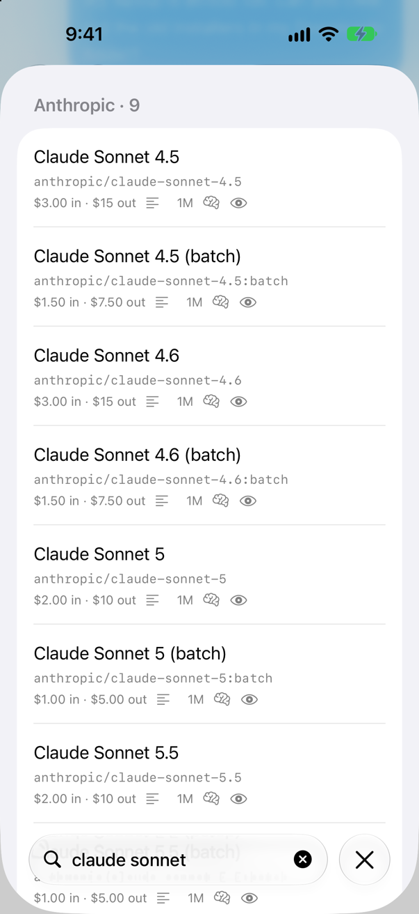
  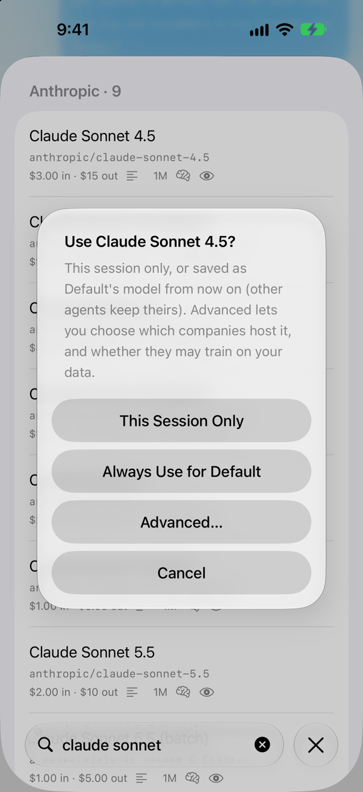
</p>

Tap a model to use it **for this session only**, **always for this agent**, or open **Advanced…**:

- **Hosts:** every company that hosts the model, cheapest first, with prices, uptime, context size, and badges for region and setup so same-named hosts can be told apart. Touch and hold a host for its privacy policy and terms.
- **Routing:** which hosts OpenRouter may use for this model: **Balanced** (OpenRouter's default), **Cheapest**, **Fastest**, **One Host**, **Prefer These** or **Only These**.
- **No training on my data:** OpenRouter skips hosts that store or train on your prompts.

Saving routing changes the agent's Hermes settings for that one model only. The app asks you to confirm, a backup is kept first (the original plus the newest ten), and Hermes uses it from the next message.

<p align="center">
  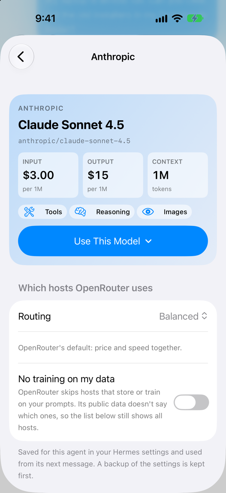
  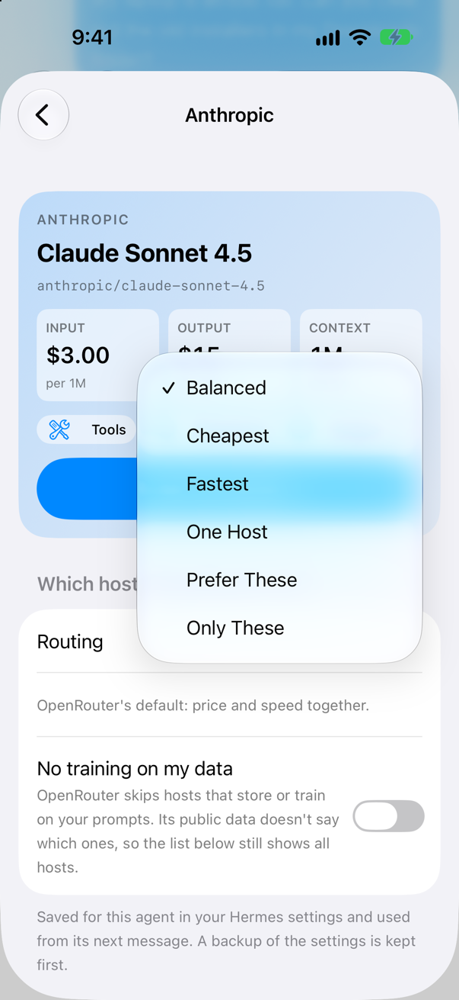
  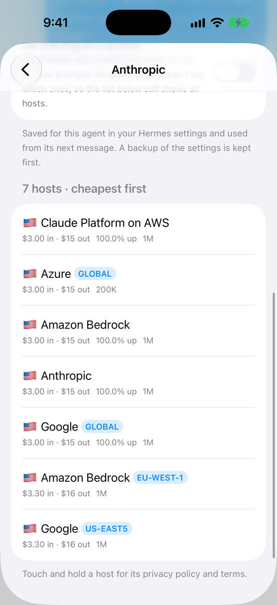
  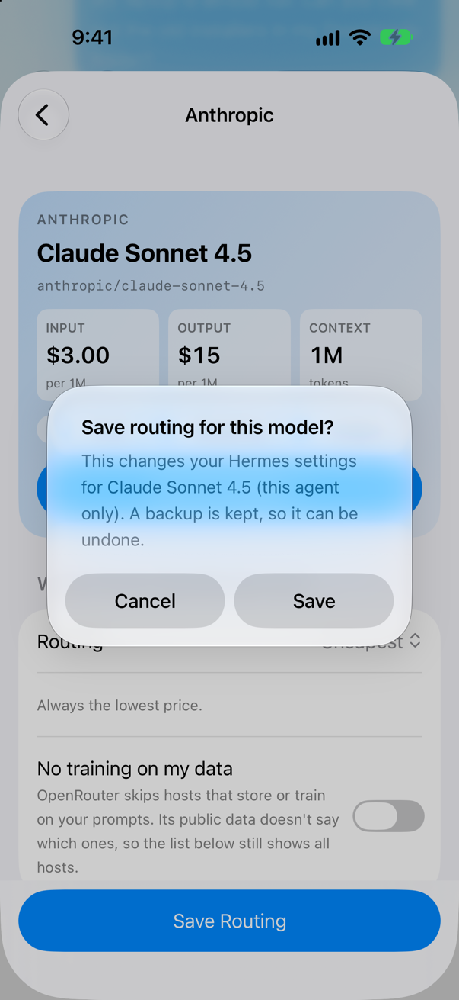
</p>

### Voice notes, voice replies and calls

**Voice notes.** With nothing typed, the message bar shows a waveform button. Hold it for half a second (a ring fills, so a stray tap does nothing), then talk. Let go to review: play it back, add more, send or discard. Your note shows as a voice bubble, with what Hermes heard in small print underneath. Hermes transcribes it with its own speech-to-text.

**Hearing replies.** Tap the speaker under any reply to hear it. The **waveform button** at the top of a chat turns on voice replies: replies then arrive as streamed voice notes, in the agent's own Hermes voice (any voice Hermes can use, including custom and plugin voices), with the text in small print underneath. Choose **Voice** (the reply as written) or **Personality Voice** (the agent writes the way it talks, in a personality and cadence you choose). Agents with no Hermes voice use your iPhone's voices, which you can pick in Chat Settings.

<p align="center">
  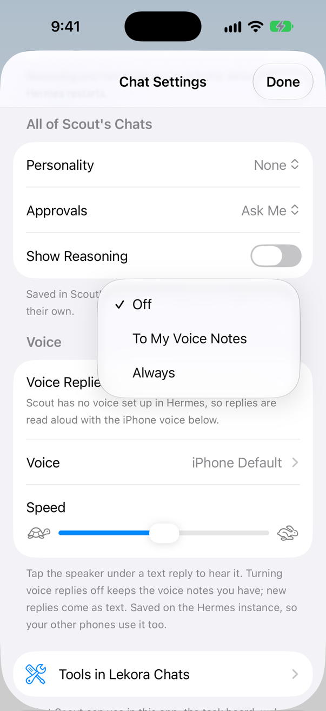
  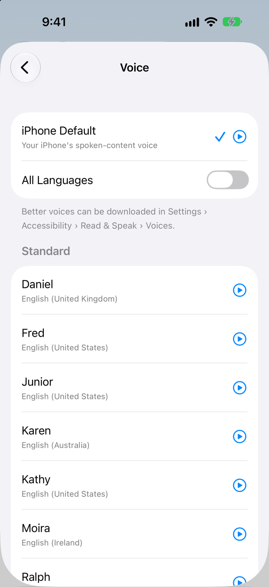
</p>

**Calls.** Tap the **headphones** button for a hands-free conversation, full screen like a call. Just talk: when you stop, your words go to the agent (recognised on your iPhone, so there's no upload and no waiting) and it answers out loud. Talk over it to interrupt. The call shows the agent's face with rings that move with your voice, and its status: *Listening…*, *Thinking…*, *Speaking…*, or *Muted*. It keeps going with the screen locked. Laughs, sighs and other sounds are noted alongside your words so the agent knows how you said it. The agent knows it's a live call, so it keeps replies short and hands longer work to a background task while it keeps talking. Everything said stays in the chat as normal messages.

<p align="center">
  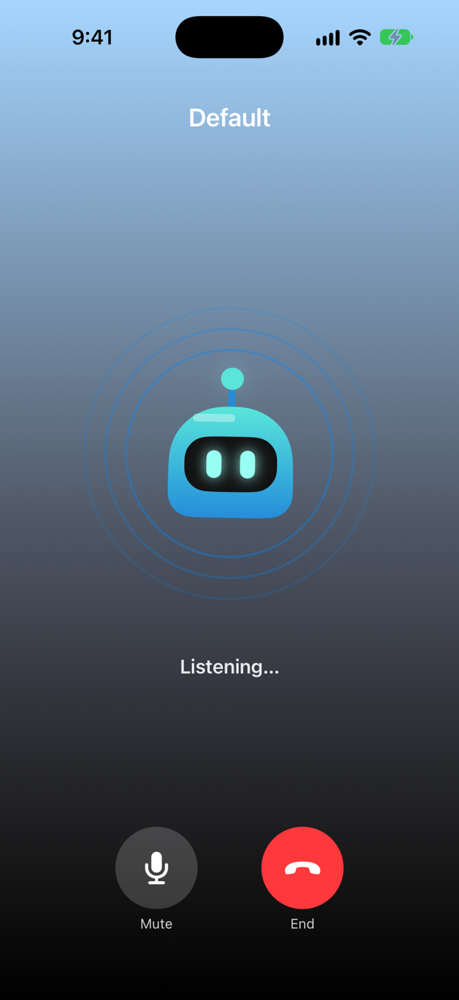
</p>

### Files

The **+** next to the message box attaches **Photos** (up to 10), a **Take Photo** shot, or **Files**. Attachments show as small previews you can remove, and upload with a progress ring. Photos show as pictures in the chat and other files as a row with an icon, name and size; tap any to open Apple's preview (zoom, read PDFs and Office files, play audio and video, share or save). Agents send files back too, with a real `send file` tool that Lekora gives them. Files are kept on your Hermes instance (up to 100 MB each), and each instance's page shows the space used.

### Artifacts

Agents can make things that open in the app as their own page instead of a wall of text: **web pages**, **documents** (Markdown), **code** (with syntax colours), **images** (SVG), **diagrams** (Mermaid) and **interactive components** (React). An artifact appears as a card in the chat, with a preview; tap to open it.

<p align="center">
  
  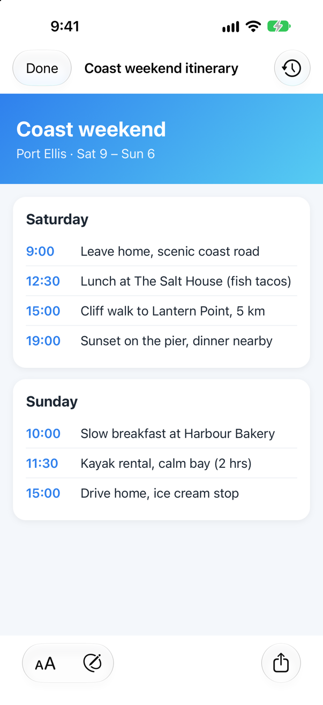
  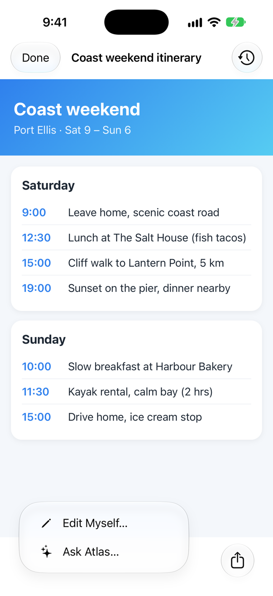
  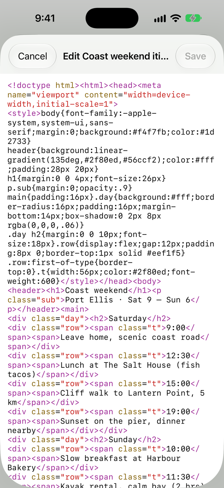
</p>

Every change is a **new version** and the earlier ones are kept (use the version arrows, and **Show Changes** to see what was removed and added). To change an artifact, **edit it yourself** in a real code editor, or **ask the agent**. In code and text you can tap a line (or a range) to add a **comment**, then **Review & Send** all of your comments at once as one structured message. If a page hits an error, you see the real error text and can **Ask the agent to fix it**. Share an artifact as the file itself, as a PDF, or copy it. Each agent has its own list of artifacts in Chat Settings.

### The task board

Hermes' own kanban board, on your phone. Open it from the menu (top left) › **Board**. It shows tasks grouped by status (Triage, Todo, Ready, Running, Blocked, Review, Done), as **lists** by default or **columns** side by side (Options menu). Filter by agent, show archived tasks, and switch boards when your instance has more than one.

<p align="center">
  
  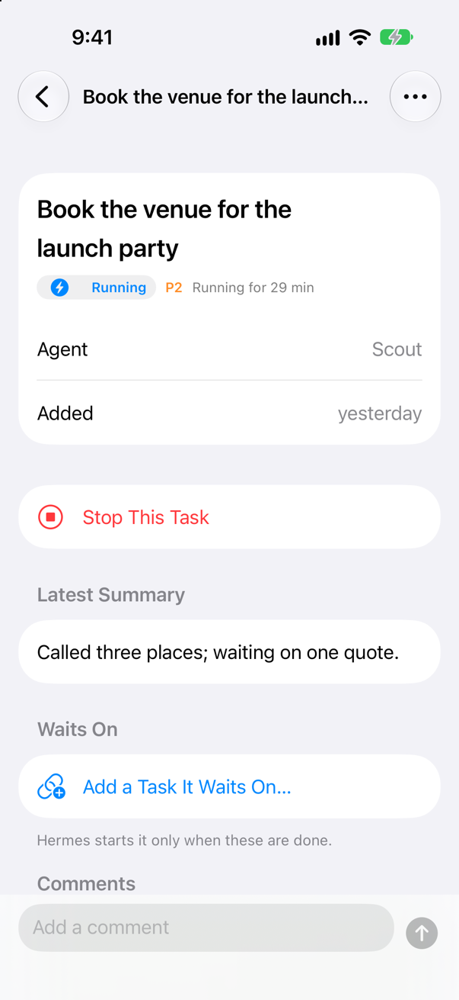
</p>

Every action is there: **New Task** (title, description, agent, priority, what it waits on), edit, **comment** (signed with your name), move (only where Hermes allows it, and if it refuses you see Hermes' reason), assign to any agent, add or remove what a task waits on, archive and restore, and **Stop** a running task. Each task shows its latest summary, every run (agent, outcome, time), comments, and its history. The board refreshes by itself within seconds of any change, by an agent, by Hermes, or from another phone. Lekora stores nothing about the board: it goes through Hermes' own kanban code, so Hermes' rules and history stay correct.

### Past chats and offline mode

One agent can have many conversations. The chat shows only the current one (as Hermes counts them: New Chat, `/new`, or Hermes' own reset), so long-used agents stay fast. Earlier conversations fold into an **Earlier chats** pill at the top. In **Past Chats** you can **search** titles and every message, read any conversation, or **Continue This Chat** to pick it up again.

If your phone can't reach the instance (no network, or Hermes restarting), you stay in your chats with everything kept on the phone; the header says "Offline". Messages you write show "sends when connected", survive quitting the app, and go out by themselves, once. Lekora retries every few seconds and is back moments after Hermes is.

### Several Hermes instances

Pair more than one Hermes instance (say, one on a Raspberry Pi and one on a Mac). Menu › **Hermes Instances** lists them with their status, and **Add Hermes Instance** pairs another. The Agents list shows every instance's agents, either by **recent** conversation (with the instance's name in small grey text) or **grouped by instance**. Each instance connects on its own, so one being off doesn't affect the others.

<p align="center">
  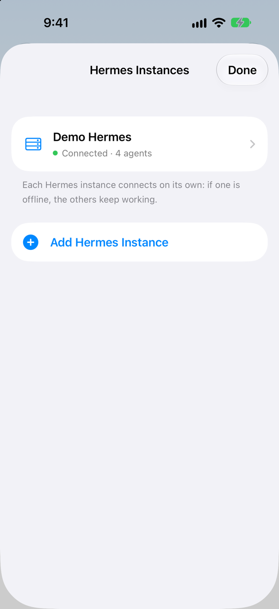
</p>

## Works anywhere Hermes does

Linux, macOS, Windows/WSL, Raspberry Pi or a VPS. The plugin uses only the Python standard library, picks its own free port, and keeps its data in Hermes's own folder.

## Coming next

The scheduler (create, pause and run Hermes' scheduled jobs), then agents delegating to each other, group chats, and usage analytics, skills and MCP management. The full plan is in [docs/product-spec.md](docs/product-spec.md). Push notifications and Apple Watch are not planned yet.

## Repository

- `app/`: the SwiftUI iPhone app
- `plugin/`: the Hermes plugin (Python) and its tests
- `docs/`: specs, protocol, data model, decisions
- `tools/demo_host.py`: a pretend Hermes with made-up agents, used to make the screenshots above
- `STATUS.md`: live progress

## License

Lekora is source-available under the [PolyForm Noncommercial License 1.0.0](LICENSE). You're free to use, run and modify it for personal, hobby, research and other noncommercial purposes. Commercial use needs written permission from the author.

## Security and privacy

- Every connection is encrypted with a certificate your machine creates itself. The pairing code carries its fingerprint, and the phone accepts only that certificate; plain connections are refused.
- Pairing codes work once and expire in 30 minutes. Phones can be listed and revoked with `hermes lekora devices`.
- Lekora never writes to Hermes config outside its own labelled section, backs up before any change, and confirms before deleting anything.
- Your chats, files and settings stay on your Hermes machine; the phone is a cache. Nothing goes to a Lekora server, because there isn't one.

More in [docs/encryption.md](docs/encryption.md).
