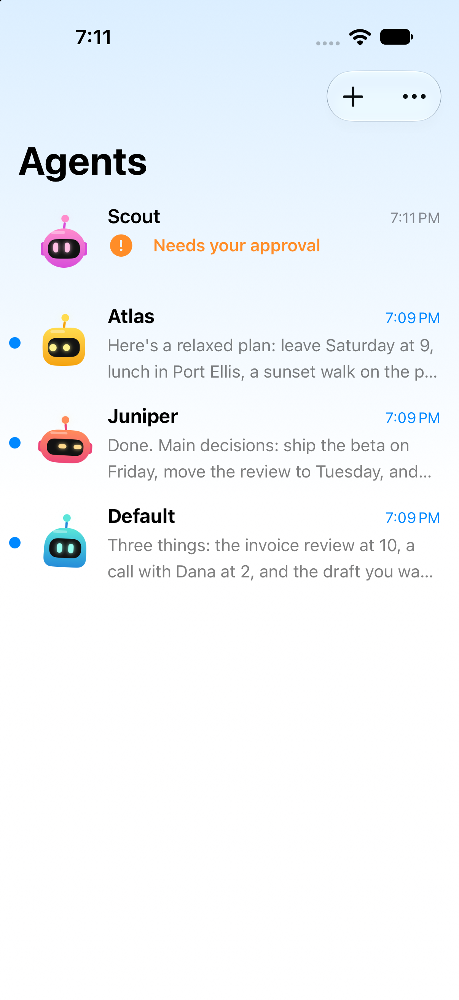
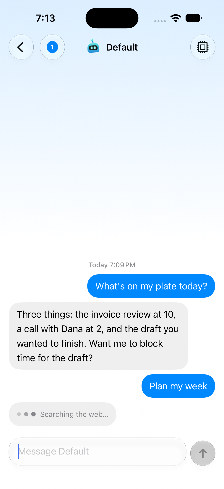
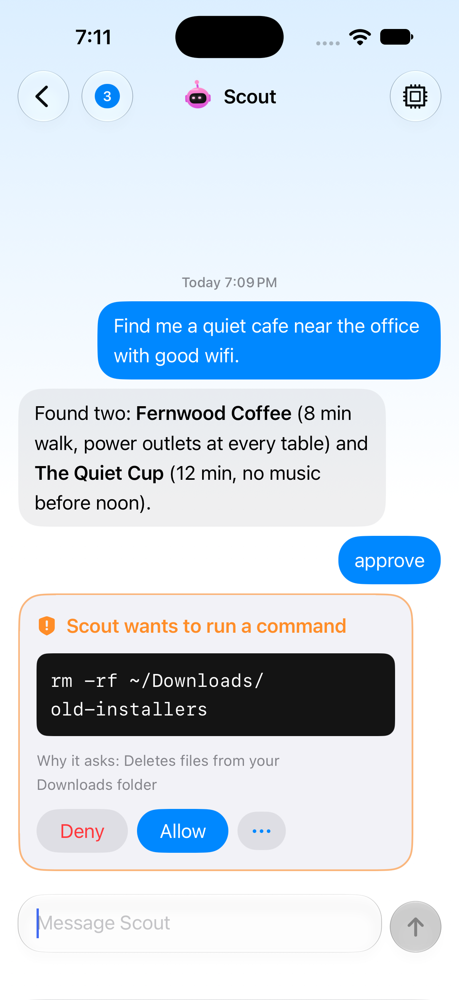
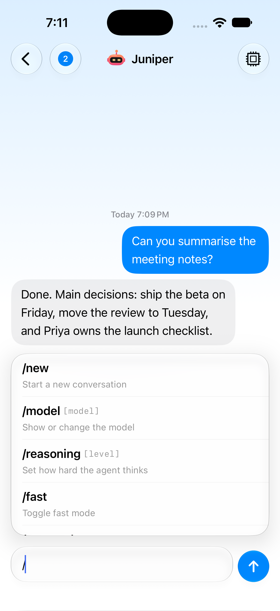

# Lekora

**A native iPhone app for your [Hermes](https://github.com/NousResearch/hermes-agent) agents.**

Lekora gives the agents you already run on Hermes a proper home on your phone: a Messages-style list of your agents, live streaming chat, and the controls Hermes normally hides behind a terminal. It sits on top of your existing Hermes. Nothing about your setup has to change, and Hermes is never made to open an API.

> **Status: alpha.** Lekora isn't on the App Store yet; for now you build the app yourself in Xcode (steps below). Phase 1 (pairing, chat, agent management) is finished and in daily use; Phase 2 (a complete chat experience) is well underway. See [STATUS.md](STATUS.md) for exactly what works today.

<p align="center">
  
  
  
  
</p>

<sub>Screenshots use a demo host with made-up agents (see <code>tools/demo_host.py</code>).</sub>

## What you get

- **Your agents, in one list.** Every Hermes profile appears with its own animated avatar, last message, time and unread dot. Create or delete agents from the phone.
- **Streaming chat.** Replies appear word by word, with a live "thinking" line ("Searching the web…") while the agent works.
- **Approvals on your phone.** When an agent needs permission (a risky command, a question for you), a card appears with Allow / Deny, a countdown and the exact command. Answer on one phone and every device updates.
- **Slash commands that suggest themselves.** Type `/` and see the agent's real commands, including your skills, plugins and quick commands, with descriptions and options.
- **Model picker.** Search every model your Hermes can use and switch in a tap. `/reasoning` and `/fast` become buttons.
- **Your data stays yours.** Chats, read state and settings live on your Hermes machine. A new phone picks up where the old one left off.
- **Private by design.** Connections are encrypted with a certificate your machine creates itself, and the phone accepts only that one. Plain connections are refused.

## How it works

Two pieces:

| Piece | Where | What it does |
|---|---|---|
| **Lekora plugin** | Your Hermes machine | Connects to Hermes natively, as a messaging platform (like Telegram or Slack). No dependencies. |
| **Lekora app** | Your iPhone | The interface. Requires iOS 26 or newer. |

The plugin install is the only technical step. Everything else happens in the app's setup, once.

## Getting started

You need Hermes 0.22 or newer, and your phone and Hermes machine on the same Wi-Fi or the same Tailscale network.

**1. Install the plugin** on the machine that runs Hermes:

```bash
cp ~/.hermes/config.yaml ~/.hermes/config.yaml.pre-lekora && \
hermes plugins install howephillip/lekora#plugin/lekora --enable && \
hermes config set platforms.lekora.enabled true && \
hermes gateway restart && \
hermes lekora pair
```

This backs up your config first, changes only two clearly labelled settings, and prints a pairing QR code.

**2. Build the app** (alpha only; an App Store release will replace this). You need a Mac with Xcode 27 and an iPhone on iOS 26 or newer:

```bash
git clone https://github.com/howephillip/lekora.git
open lekora/app/Lekora.xcodeproj
```

In Xcode, select the Lekora target, set your own team under Signing & Capabilities, choose your iPhone, and press Run.

**3. Pair.** Open the app, scan the code (or tap the pairing link), choose which agents to show, and start chatting.

Full details, including removing phones and undoing the install, are in [docs/install.md](docs/install.md).

## Works anywhere Hermes does

Linux, macOS, Windows/WSL, Raspberry Pi or a VPS. The plugin uses only the Python standard library, picks its own free port, and keeps its data in Hermes's own folder.

## Coming next

Sending files both ways, voice, agent-made artifacts, kanban and scheduler views, delegation and group chats, and usage analytics. The full plan is in [docs/product-spec.md](docs/product-spec.md). Push notifications and Apple Watch are not planned yet.

## Repository

- `app/`: the SwiftUI iPhone app
- `plugin/`: the Hermes plugin (Python) and its tests
- `docs/`: specs, protocol, data model, decisions
- `STATUS.md`: live progress

## License

Lekora is source-available under the [PolyForm Noncommercial License 1.0.0](LICENSE). You're free to use, run and modify it for personal, hobby, research and other noncommercial purposes. Commercial use needs written permission from the author.

## Security

Pairing codes work once and expire in 30 minutes. Phones can be listed and revoked with `hermes lekora devices`. Lekora never writes to Hermes config outside its own labelled section, backs up before any change, and confirms before deleting anything. More in [docs/encryption.md](docs/encryption.md).
