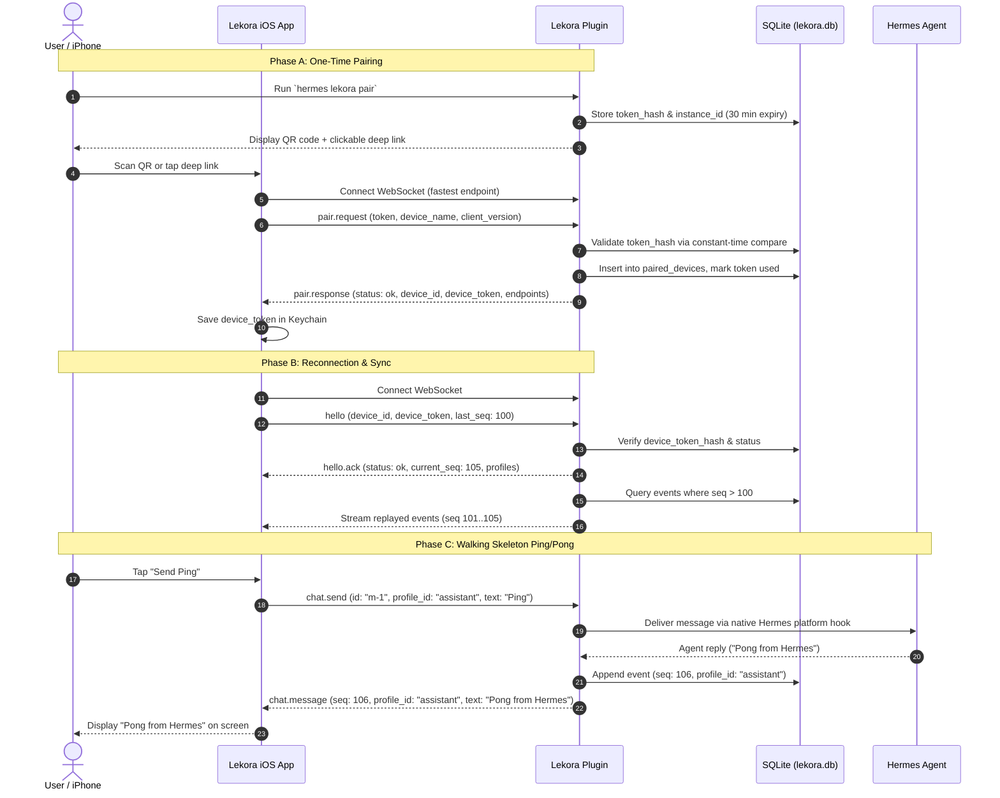

# Lekora Walking Skeleton

*   **Author:** howephillip
*   **Status:** Approved (Post-Review Revision)
*   **Date:** 2026-11-07

--------------------------------------------------------------------------------

## Overview

Lekora is a native iOS companion app and host plugin for Hermes agent installations. This design specifies the Phase 1 Walking Skeleton: the minimal end-to-end slice that validates native plugin installation, dynamic pairing across networks, credential exchange, and bidirectional WebSocket communication between an iPhone and a Hermes host machine.

## The Problem

Hermes agents run on local machines, headless servers, or homelabs. Users who want to interact with their agents from a mobile device currently face two friction points:
1. Complex networking setup: Requiring static IP assignments, port forwarding, or rigid host bindings that fail when switching between home Wi-Fi and mobile data.
2. Heavy, invasive architecture: Requiring full-blown web dashboard servers, external proxy dependencies, or custom modifications to Hermes core code.

The Phase 1 Walking Skeleton solves this by establishing a non-invasive, dynamic pairing mechanism. The plugin runs inside Hermes as a native platform client, picks an available local port dynamically (persisting it for subsequent restarts), and generates a multi-route pairing invitation. The iOS app connects over whichever route is open (local network or Tailscale), establishes a persistent cryptographic device session in iOS Keychain, and confirms live connectivity with a ping/pong exchange.

## Goals

*   Zero Hermes core modifications: Hermes connects to the Lekora plugin natively as an internal messaging platform.
*   Single-command host setup: The user installs the plugin once on the Hermes machine, which handles port selection and route advertisement automatically.
*   Dynamic multi-route pairing: The pairing invitation advertises local LAN and Tailscale MagicDNS/IP endpoints; the mobile app connects across whatever transport is reachable.
*   Persistent credentials & stable ports: Host-generated device credentials persist in the iOS Keychain and SQLite host store, allowing seamless reconnects across network changes without re-pairing. The plugin persists its allocated port in `lekora.db` so host restarts do not break cached client endpoints.
*   Profile equality from day one: All agent profiles are strictly equal; no privileged "main" agent exists.
*   Flexible mobile-friendly onboarding: Support both external screen QR scanning and mobile-native pairing (copy-paste deep link or token into the wizard).
*   End-to-end connectivity verification: Successfully transmit a test message ("Ping") from the iPhone and receive a streamed reply back from the Hermes agent ("Pong from Hermes") through the WebSocket gateway.

## Non-Goals

*   Push notifications: APNs integration is explicitly deferred. Messaging operates while the app is active or reconnecting.
*   Apple Watch companion app: Watch targets are out of scope.
*   Telemetry & analytics engine: Token usage tracking and operational analytics are deferred to Phase 8 per the product spec.
*   Voice streaming pipeline: Audio capture and playback are deferred to Phase 4.
*   Sandboxed artifact rendering: Interactive HTML/document rendering is deferred to Phase 5.
*   Multi-agent group routing or delegation: Complex orchestration is deferred to Phase 7.
*   Kanban and scheduler UI: Hermes dashboard synchronization is deferred to Phase 6.

## Resolved Decisions & Remaining Questions

*   **Hermes Version Compatibility**: Baseline targets the latest Hermes version. On startup, the plugin verifies Hermes package/runtime version against its supported range; if incompatible, it halts cleanly with a descriptive terminal error rather than failing silently.
*   **Pairing Invite Expiration**: One-time pairing invitation tokens expire after 30 minutes.
*   **Port Persistence Across Restarts**: The plugin binds to an OS-allocated ephemeral port on first initialization, records `bound_port` in `instance_metadata` inside `lekora.db`, and requests that specific port on future restarts. If a port conflict occurs, it allocates a new port and updates `bound_port`.
*   **Profile Equality (AGENTS.md Rule 5)**: In compliance with Rule 5 ("All profiles are equal. No 'main agent'"), all profiles in wire contracts and sample fixtures use neutral identifiers (e.g. `"assistant"`, `"coder"`). No `"main"` profile exists.
*   **iOS Local Network Permission Resolution**: When probing LAN endpoints, iOS triggers a system local network prompt. `RouteProber` handles `POSIXError.EHOSTUNREACH` or connection timeouts gracefully without aborting probes to Tailscale endpoints. If LAN is denied and Tailscale is reachable, pairing succeeds seamlessly. If all routes fail, the setup wizard guides the user to verify Local Network permissions in iOS Settings or connect via Tailscale.

## Critical User Journeys (CUJs)

### CUJ 1: First-Time Pairing (Multi-Modal Intake)

*   **Given**: Hermes is running on the host machine with the Lekora plugin installed. The user has installed the Lekora iOS app on their iPhone.
*   **When**: 
    *   *Case A (Desktop/Homelab Screen)*: The user views the Hermes terminal on a computer monitor and scans the generated QR code using the Lekora app.
    *   *Case B (Mobile SSH / Termius / Chat)*: The user interacts with Hermes via an iPhone terminal (e.g., Termius) or asks their agent for a pairing link. The plugin outputs both a terminal QR code and a clickable deep link (`lekora-pair://pair?...`) / copyable token. Tapping the link opens Lekora directly, or the user taps "Paste Token" in the setup wizard.
*   **Then**: The app connects to the fastest reachable endpoint, exchanges `pair.request` for `pair.response`, stores the returned `device_token` securely in Keychain, and displays the connected status.

### CUJ 2: Reconnection Handshake Across Network Change or Host Restart

*   **Given**: The phone was previously paired on local home Wi-Fi and the user leaves the home network to cellular data (with Tailscale enabled), or the Hermes host machine restarts.
*   **When**: The Lekora app returns to the foreground.
*   **Then**: The app tries its cached candidate endpoints, re-establishes the WebSocket connection over the active route (local LAN or Tailscale), sends a `hello` handshake with its `device_token` and `last_seq`, receives a `hello.ack`, and catches up on any missed events.

### CUJ 3: End-to-End Connectivity Test

*   **Given**: The phone is paired and connected to the Hermes host.
*   **When**: The user sends a test ping from the app (`chat.send` with text "Ping").
*   **Then**: The host routes the message to the Hermes agent via the native platform hook, which replies back over the WebSocket gateway (`chat.message` with text "Pong from Hermes"), confirming full end-to-end operational readiness.

--------------------------------------------------------------------------------

## Technical Plan (Architecture)

### 1. Architectural Topology

Lekora uses an asymmetric client-host architecture. The Hermes host acts as the single source of truth; the iOS device operates as a high-speed reactive cache with secure local credential storage.

```
+-------------------------------------------------------------+
|                        Hermes Host                          |
|                                                             |
|  +-------------------------------------------------------+  |
|  |                 Hermes Agent Platform                 |  |
|  +---------------------------+---------------------------+  |
|                              | Native Platform Messaging     |
|  +---------------------------v---------------------------+  |
|  |                   Lekora Host Plugin                  |  |
|  |                                                       |  |
|  |  +-----------------+  +----------------------------+  |  |
|  |  | SQLite Storage  |  | Dynamic Route & Persistent |  |  |
|  |  | (lekora.db)     |  | Port Resolver (LAN/TS)     |  |  |
|  |  +-----------------+  +----------------------------+  |  |
|  |  +-------------------------------------------------+  |  |
|  |  |         WebSocket Gateway (JSON Envelopes)      |  |  |
|  |  +-------------------------------------------------+  |  |
|  +---------------------------^---------------------------+  |
+------------------------------|------------------------------+
                               |
                   WebSocket (LAN / Tailscale)
                               |
+------------------------------v------------------------------+
|                       iOS Mobile App                        |
|                                                             |
|  +---------------------------+---------------------------+  |
|  | Gateway Connection Mgr    | Route Race Prober         |  |
|  | (URLSessionWebSocketTask) | (Verified Ping Check)     |  |
|  +---------------------------+---------------------------+  |
|  | Secure Vault (Keychain)   | Local State & Event Cache |  |
|  | (device_token, instance)  | (seq tracking, profiles)  |  |
|  +---------------------------+---------------------------+  |
|  |                   SwiftUI User Interface              |  |
|  | (Setup Wizard, Pairing Scanner, Live Ping/Chat View)  |  |
|  +-------------------------------------------------------+  |
+-------------------------------------------------------------+
```

### 2. Host Plugin Component Architecture

The plugin is implemented in Python and executed inside the Hermes runtime environment.

1. **Version Gate & Runtime Hook**:
   - Inspects `hermes.__version__` or package metadata at initialization.
   - Verifies compatibility with the target Hermes release. If mismatched, terminates startup cleanly and outputs instructions to the terminal.
   - Registers as an internal messaging platform within Hermes. Implements Hermes's platform message handler interface to dispatch user messages to agents and receive streamed agent responses.
2. **Network Route & Persistent Port Resolver**:
   - Checks `instance_metadata` in `lekora.db` for a previously bound port. If present, attempts to bind to that port; if absent or occupied, binds to port `0` and stores the newly assigned port.
   - Filters out virtual/bridge network interfaces (`docker0`, `br-*`, `veth*`, `virbr*`, `tun*`, `tap*`) to ensure candidate endpoints only contain routable addresses.
   - Queries network interfaces for:
     - Local LAN IPv4 addresses (excluding loopback).
     - Tailscale interfaces and MagicDNS hostnames (via `tailscale status --json` or environment checks across standard binary paths).
     - Explicit user-configured hostnames (if provided in plugin configuration).
   - Combines detected routes into candidate WebSocket URIs.
3. **SQLite Host Store (`lekora.db`)**:
   - Located in the Hermes application data directory (`~/.hermes/lekora.db` or configured data path).
   - Complies with AGENTS.md Rule 6: records carry `instance_id` from day one.
   - Tables:
     - `instance_metadata`: `key` (TEXT PRIMARY KEY), `value` (TEXT NOT NULL). Stores `instance_id` (UUID generated on initial setup), `instance_name`, and `bound_port`.
     - `pairing_invites`: `token_hash` (TEXT PRIMARY KEY), `instance_id` (TEXT NOT NULL), `created_at` (TEXT), `expires_at` (TEXT), `used_at` (TEXT), `client_ip` (TEXT).
     - `paired_devices`: `device_id` (TEXT PRIMARY KEY), `instance_id` (TEXT NOT NULL), `device_token_hash` (TEXT NOT NULL), `device_name` (TEXT), `client_version` (TEXT), `paired_at` (TEXT), `last_seen_at` (TEXT), `revoked_at` (TEXT).
     - `events`: `seq` (INTEGER PRIMARY KEY AUTOINCREMENT), `instance_id` (TEXT NOT NULL), `profile_id` (TEXT NOT NULL), `event_type` (TEXT NOT NULL), `payload_json` (TEXT NOT NULL), `created_at` (TEXT).
4. **Pairing Invitation Generator (CLI & Agent Tool)**:
   - Command: `hermes lekora pair` generates a cryptographically random one-time token (256-bit URL-safe base64) and stores its salted SHA-256 hash in `pairing_invites`.
   - Generates the URI:
     `lekora-pair://pair?token=<token>&instance_id=<instance_id>&endpoints=<csv_encoded_urls>`
   - Renders both:
     - ANSI terminal QR code using pure standard-library Unicode block characters.
     - Clickable URI and plain-text copyable string for mobile SSH sessions (e.g. Termius).
5. **WebSocket Gateway Server**:
   - Lightweight asynchronous WebSocket listener.
   - Enforces authentication: unauthenticated connections may only execute `pair.request` or `hello`. Unauthenticated connections that do not authenticate within 5 seconds are closed to prevent connection starvation.
   - Authenticates connections against `pairing_invites` or `paired_devices` using constant-time hash comparisons (`secrets.compare_digest`).
   - Dispatches incoming `chat.send` events to Hermes agent session and streams replies back as sequenced `chat.message` events.

### 3. iOS Client Architecture (SwiftUI)

The client is built using native Swift with SwiftUI, targeting iOS 27 primary and iOS 26 minimum.

1. **Setup & Pairing Coordinator**:
   - **Camera Scanner**: Integrated `AVCaptureSession` scanning for `lekora-pair://` QR codes.
   - **Deep Link Handler**: Catches `onOpenURL` for `lekora-pair://` incoming links from iOS terminal apps or shared links.
   - **Manual / Paste Entry**: Explicit "Paste Pairing Code" button that reads the clipboard with user consent (avoiding automatic clipboard-sniffing banners).
2. **Endpoint Connection Prober**:
   - Receives multiple endpoint URIs from the invitation or cached configuration.
   - Executes parallel connection probes (`URLSessionWebSocketTask`) with a 3-second timeout.
   - Verifies connection readiness by awaiting `task.sendPing` or WebSocket open before declaring a winner, cancelling slower candidates.
   - Handles `POSIXError.EHOSTUNREACH` gracefully, falling back to Tailscale without failing the entire wizard.
3. **Keychain Security Vault**:
   - Persists `device_token`, `device_id`, and `instance_id` using the iOS Security framework (`kSecClassGenericPassword`).
   - Implements an upsert strategy (`SecItemDelete` then `SecItemAdd`) scoped to service `com.lekora.app`.
   - Ensures credentials survive app reinstallations and are excluded from iCloud backups (`kSecAttrAccessibleAfterFirstUnlockThisDeviceOnly`).
4. **Lifecycle & Foreground Reconnection**:
   - Observes scene phase changes (`scenePhase == .active`). On returning to foreground, immediately validates connection state and reconnects over cached endpoints if disconnected.
   - Tracks `last_seq` locally and sends it in the `hello` payload to catch up on any missed events.

### 4. Protocol Message Flow



### 5. Detailed Message Wire Schemas

All messages use standard JSON envelopes:
```json
{
  "v": 1,
  "id": "<uuid-string>",
  "type": "<message_type>",
  "instance_id": "<instance_id>",
  "profile_id": "<profile_id>",
  "ts": "<iso8601-utc-timestamp>",
  "data": { }
}
```
*Envelope Rules:*
- `instance_id` is mandatory on all messages.
- `profile_id` is optional (`null` or omitted) on system handshake envelopes (`pair.*`, `hello.*`, `error`), and mandatory on all conversation/agent messages (`chat.*`).

#### A. Pairing (`pair.request` & `pair.response`)

*`pair.request`*:
```json
{
  "v": 1,
  "id": "c1f7a29e-4e3a-4a2e-9d2a-8b1e0f3a4b5c",
  "type": "pair.request",
  "instance_id": "inst_01j9a8b7c6d5e4f3",
  "ts": "2026-11-07T20:55:00Z",
  "data": {
    "pairing_token": "tok_9a8b7c6d5e4f3a2b1c0d",
    "device_name": "Phillip's iPhone",
    "client_version": "1.0.0",
    "supported_proto_versions": [1]
  }
}
```

*`pair.response` (Success)*:
```json
{
  "v": 1,
  "id": "c1f7a29e-4e3a-4a2e-9d2a-8b1e0f3a4b5c",
  "type": "pair.response",
  "instance_id": "inst_01j9a8b7c6d5e4f3",
  "ts": "2026-11-07T20:55:01Z",
  "data": {
    "status": "ok",
    "proto_version": 1,
    "device_id": "dev_7a8b9c0d",
    "device_token": "sec_99a8b7c6d5e4f3a2b1c0d8e7f6a5b4c3",
    "instance_name": "Home Server",
    "endpoints": [
      "ws://192.168.1.120:49152",
      "ws://hermes-host.tailnet01.ts.net:49152"
    ]
  }
}
```

#### B. Session Handshake (`hello` & `hello.ack`)

*`hello`*:
```json
{
  "v": 1,
  "id": "f8a7b6c5-1d2e-3f4a-5b6c-7d8e9f0a1b2c",
  "type": "hello",
  "instance_id": "inst_01j9a8b7c6d5e4f3",
  "ts": "2026-11-07T21:00:00Z",
  "data": {
    "device_id": "dev_7a8b9c0d",
    "device_token": "sec_99a8b7c6d5e4f3a2b1c0d8e7f6a5b4c3",
    "last_seq": 0,
    "client_version": "1.0.0",
    "proto_version": 1
  }
}
```

*`hello.ack` (Success - Profile Equality per AGENTS.md Rule 5)*:
```json
{
  "v": 1,
  "id": "f8a7b6c5-1d2e-3f4a-5b6c-7d8e9f0a1b2c",
  "type": "hello.ack",
  "instance_id": "inst_01j9a8b7c6d5e4f3",
  "ts": "2026-11-07T21:00:01Z",
  "data": {
    "status": "ok",
    "current_seq": 0,
    "instance_name": "Home Server",
    "profiles": [
      {
        "profile_id": "assistant",
        "name": "Hermes Assistant",
        "avatar": "sparkles"
      }
    ]
  }
}
```

#### C. Walking Skeleton Test Messages (`chat.send` & `chat.message`)

*`chat.send` (Client -> Host)*:
```json
{
  "v": 1,
  "id": "a1b2c3d4-e5f6-7a8b-9c0d-1e2f3a4b5c6d",
  "type": "chat.send",
  "instance_id": "inst_01j9a8b7c6d5e4f3",
  "profile_id": "assistant",
  "ts": "2026-11-07T21:05:00Z",
  "data": {
    "text": "Ping"
  }
}
```

*`chat.message` (Host -> Client)*:
```json
{
  "v": 1,
  "id": "e5f6a7b8-c9d0-1e2f-3a4b-5c6d7e8f9a0b",
  "type": "chat.message",
  "instance_id": "inst_01j9a8b7c6d5e4f3",
  "profile_id": "assistant",
  "ts": "2026-11-07T21:05:01Z",
  "data": {
    "seq": 106,
    "role": "assistant",
    "text": "Pong from Hermes"
  }
}
```

#### D. Standardized Error Response (`error`)

*`error` (Host -> Client)*:
```json
{
  "v": 1,
  "id": "d0e1f2a3-b4c5-6d7e-8f9a-0b1c2d3e4f5a",
  "type": "error",
  "instance_id": "inst_01j9a8b7c6d5e4f3",
  "ts": "2026-11-07T21:00:01Z",
  "data": {
    "code": "AUTH_FAILED",
    "reason": "Invalid or revoked device token",
    "recoverable": false
  }
}
```
*Standard Error Codes:*
- `TOKEN_EXPIRED`: The 30-minute pairing token has expired.
- `TOKEN_INVALID`: The pairing token does not match any pending invite.
- `AUTH_FAILED`: The provided `device_token` hash is invalid or revoked.
- `INCOMPATIBLE_VERSION`: Client protocol version is unsupported.

--------------------------------------------------------------------------------

## Alternatives Considered

### Alternative A: Custom HTTP REST API on Hermes Host

*   **Description**: Expose standard HTTP REST endpoints on the Hermes host (e.g., `/api/pair`, `/api/chat`) alongside an SSE or long-polling endpoint for updates.
*   **Pros**: Simple request/response semantics; easy testing via `curl` or HTTP clients.
*   **Cons**: Lacks true bidirectional capabilities. The Hermes agent cannot proactively push events or start conversations without persistent client polling or additional background connections. Increases battery drain and latency on mobile.
*   **Reason for Rejection**: `Rejected by author: A single persistent WebSocket connection provides true bidirectional streaming and proactive agent-initiated messaging with minimal resource overhead, matching the foundational live gateway requirement.`

### Alternative B: Static IP and Fixed Port Binding

*   **Description**: Hardcode a default port (e.g., 8080) and require the user to configure their machine's static IP address or setup local router DHCP reservations.
*   **Pros**: Trivial discovery logic; simpler initial pairing script without route detection.
*   **Cons**: High risk of port conflicts with existing services on user host machines. Fails immediately whenever the iPhone leaves home Wi-Fi and connects via cellular data.
*   **Reason for Rejection**: `Rejected by author: Dynamic port allocation with persistent storage in lekora.db eliminates collision risks and ensures port stability across host restarts. Multi-route discovery (LAN + Tailscale) allows the mobile app to function whether on home Wi-Fi or cellular data.`

### Alternative C: Third-Party Hosted Cloud Relay

*   **Description**: Route all mobile-to-host traffic through an intermediary hosted cloud proxy or SaaS synchronization server.
*   **Pros**: Simplifies NAT traversal for users without Tailscale.
*   **Cons**: Violates privacy by routing private agent chats and files through third-party servers. Introduces recurring server infrastructure costs and requires user account management.
*   **Reason for Rejection**: `Rejected by author: Violates non-negotiable principle 9 (no paid accounts or external dependencies). Direct peer-to-peer transport (LAN + Tailscale) preserves privacy, has zero operating cost, and requires no external accounts.`

--------------------------------------------------------------------------------

## Non-Functional Requirements

### Security & Privacy
*   **Direct Peer Transport**: Core chat, file transfers, and agent execution remain strictly between the user's iOS device and their Hermes host machine with no third-party middleman.
*   **Hashed Token Storage**: The host stores only salted SHA-256 hashes of pairing tokens (`token_hash`) and device credentials (`device_token_hash`). All token verifications utilize constant-time comparisons (`secrets.compare_digest`).
*   **Secure Credential Storage**: Persistent device tokens are stored in the iOS Keychain with `kSecAttrAccessibleAfterFirstUnlockThisDeviceOnly`.
*   **Single-Use Ephemeral Invites**: Pairing invitation tokens are cryptographically random 256-bit strings that expire after 30 minutes and are strictly single-use.
*   **Connection Starvation Protection**: Unauthenticated WebSocket connections that fail to deliver a valid `pair.request` or `hello` within 5 seconds are closed automatically.
*   **Telemetry Deferred**: Per AGENTS.md Rule 9 and product specifications, telemetry and token analytics are deferred to Phase 8.

### Performance & Latency
*   **Fast Connection Establishment**: The parallel endpoint racer probes candidate endpoints simultaneously, completing the initial socket connection in under 50ms on LAN and under 150ms over Tailscale.
*   **Minimal Idle Overhead**: Idle WebSocket connections transmit periodic heartbeat pings (every 30s) to keep sockets alive with negligible battery impact.

### Resilience & Offline Recovery
*   **Monotonic Event Catchup**: All server events increment a monotonic integer `seq`. Upon reconnecting, the client presents `last_seq` and receives missing events sequentially, eliminating dropped messages during Wi-Fi to cellular transitions.
*   **Persistent Port Allocation**: The plugin rebinds to its saved port across restarts, preventing client disconnection loops.

--------------------------------------------------------------------------------

### Additional Resources
*   [concepts_brief.md](../concepts_brief.md): Ideation and architectural decisions.
*   [protocol.md](../protocol.md): Core envelope and handshake protocol specification.
*   [data-model.md](../data-model.md): Host SQLite source-of-truth schema guidelines.
*   [decisions.md](../decisions.md): Project architecture and naming records.

### Future Improvements
*   **Public Key Cryptography**: Replace shared bearer tokens with asymmetric public/private key pairs (Curve25519) where the iPhone signs handshake challenges.
*   **Apple Watch Companion**: Lightweight watchOS target for receiving agent notifications and issuing quick voice commands (deferred past Phase 1).

--------------------------------------------------------------------------------

## Detailed Implementation Plan

This section provides the file-level blueprint for building the Phase 1 Walking Skeleton. Every component, protocol handler, and test file is enumerated with its precise scope and rationale.

### Target Files to Create/Modify

#### 1. Host Plugin Components (Python)

##### `plugin/lekora/__init__.py` (Create)
*   **Type / Scope**: Python Package Entrypoint.
*   **Proposed Changes**: Defines package metadata, version string (`__version__ = "0.1.0"`), and exports core plugin entrypoints.

##### `plugin/lekora/plugin.py` (Create)
*   **Type / Scope**: Hermes Native Platform Plugin.
*   **Proposed Changes**: Implements Hermes native platform messaging interfaces. Performs runtime startup validation against `hermes.__version__`, cleanly logging an error and halting if incompatible. Initializes the SQLite store, manages the persistent port assignment, and starts the asynchronous WebSocket gateway background task.

##### `plugin/lekora/routes.py` (Create)
*   **Type / Scope**: Dynamic Port & Route Resolver.
*   **Proposed Changes**:
    *   Resolves active routable local LAN IPv4 addresses (filtering out virtual bridge adapters: `docker0`, `br-*`, `veth*`).
    *   Detects active Tailscale status and resolves MagicDNS FQDNs and Tailscale IPs across standard executable paths.
    *   Exports `resolve_candidate_endpoints(port: int) -> list[str]`.

##### `plugin/lekora/store.py` (Create)
*   **Type / Scope**: SQLite Host Storage Engine.
*   **Proposed Changes**:
    *   Manages connection and migrations for `lekora.db` inside Hermes data directory.
    *   Creates tables: `instance_metadata`, `pairing_invites`, `paired_devices`, and `events`.
    *   Provides atomic CRUD methods: `get_or_create_instance_id()`, `get_persisted_port()`, `set_persisted_port()`, `create_invite()`, `consume_invite()`, `register_device()`, `verify_device_token()`, `append_event()`, and `fetch_events_since(last_seq: int)`.

##### `plugin/lekora/gateway.py` (Create)
*   **Type / Scope**: Asynchronous WebSocket Gateway Server.
*   **Proposed Changes**:
    *   Runs an `asyncio`-based WebSocket listener on the resolved port.
    *   Enforces 5-second unauthenticated handshake timeout.
    *   Routes incoming JSON envelopes based on `type`.
    *   Enforces authentication: unauthenticated connections may only execute `pair.request` or `hello`.
    *   Dispatches incoming `chat.send` events to Hermes agent session and streams replies back as sequenced `chat.message` events.

##### `plugin/lekora/pairing.py` (Create)
*   **Type / Scope**: Pairing CLI Command & Token Generator.
*   **Proposed Changes**:
    *   Provides CLI sub-command: `hermes lekora pair`.
    *   Generates a cryptographically random 256-bit URL-safe token with a 30-minute expiration.
    *   Stores salted SHA-256 hash in `pairing_invites`.
    *   Renders an ANSI terminal QR code using standard library Unicode block characters.
    *   Outputs the clickable deep link (`lekora-pair://pair?...`) and copyable token string for terminal clients (Termius) and mobile chat.

##### `plugin/tests/conftest.py` (Create)
*   **Type / Scope**: Pytest Test Fixtures & Mock Agent.
*   **Proposed Changes**: Configures ephemeral in-memory/temp SQLite databases and mock Hermes agent hooks for unit and integration tests.

##### `plugin/tests/test_store.py` (Create)
*   **Type / Scope**: Unit Test Suite for Database Layer.
*   **Proposed Changes**: Validates schema creation, one-time invite token consumption, 30-minute expiration enforcement, monotonic `seq` ordering, `instance_metadata` persistence, and token hash validation.

##### `plugin/tests/test_routes.py` (Create)
*   **Type / Scope**: Unit Test Suite for Route Discovery.
*   **Proposed Changes**: Tests candidate endpoint URL generation with mocked network interfaces, bridge filtering, and Tailscale CLI outputs.

##### `plugin/tests/test_gateway.py` (Create)
*   **Type / Scope**: Integration Test Suite for WebSocket Gateway.
*   **Proposed Changes**: Starts the gateway on an ephemeral test port. Tests full protocol flow: `pair.request` -> `pair.response`, reconnect with `hello` -> `hello.ack`, event replay, ping message exchange, error envelopes, and invalid credential rejections.

---

#### 2. iOS Mobile App Components (Swift / SwiftUI)

##### `app/Lekora/LekoraApp.swift` (Create)
*   **Type / Scope**: Main App Entrypoint & URL Scheme Router.
*   **Proposed Changes**: Initializes app state and handles `onOpenURL` to capture `lekora-pair://` deep links when launched from external iOS apps or mobile terminals.

##### `app/Lekora/Models/ProtocolMessages.swift` (Create)
*   **Type / Scope**: Protocol Data Models (`Codable`).
*   **Proposed Changes**: Swift structs representing protocol wire envelopes: `Envelope<T>`, `PairRequestData`, `PairResponseData`, `HelloData`, `HelloAckData`, `ChatSendData`, `ChatMessageData`, and `ErrorData`.

##### `app/Lekora/Services/KeychainManager.swift` (Create)
*   **Type / Scope**: Secure Credential Vault.
*   **Proposed Changes**: Encapsulates iOS Keychain APIs (`kSecClassGenericPassword`). Implements clean upsert strategy to securely write, read, and delete `device_token`, `device_id`, and `instance_id` with `kSecAttrAccessibleAfterFirstUnlockThisDeviceOnly`.

##### `app/Lekora/Services/RouteProber.swift` (Create)
*   **Type / Scope**: Multi-Endpoint Race Prober.
*   **Proposed Changes**: Accepts an array of candidate endpoint URLs (LAN and Tailscale). Uses `TaskGroup` to attempt concurrent connections with `URLSessionWebSocketTask` and a 3-second timeout. Verifies connection readiness via ping check before selecting the winner. Catches `POSIXError.EHOSTUNREACH` gracefully to fall back to Tailscale without error dialogs.

##### `app/Lekora/Services/GatewayClient.swift` (Create)
*   **Type / Scope**: WebSocket Client Actor (`URLSessionWebSocketTask`).
*   **Proposed Changes**:
    *   Maintains the active socket connection to the host.
    *   Handles outgoing message transmission and background message receiving loop.
    *   Sends periodic ping heartbeats every 30 seconds.
    *   Implements exponential backoff auto-reconnect upon unexpected socket disconnection.
    *   Monitors `scenePhase` to immediately re-verify socket health upon returning to the foreground.

##### `app/Lekora/Views/Setup/SetupWizardView.swift` (Create)
*   **Type / Scope**: SwiftUI Onboarding & Pairing Screen.
*   **Proposed Changes**: Multi-modal pairing interface allowing:
    *   Scanning a desktop terminal QR code via camera.
    *   One-tap confirmation if launched via `lekora-pair://` deep link.
    *   Explicit "Paste Token" button or manual text entry for copy-pasted invite codes.
    *   Displays progress spinner and connection state during endpoint probing.

##### `app/Lekora/Views/Setup/QRScannerView.swift` (Create)
*   **Type / Scope**: Camera QR Scanner Component (`UIViewControllerRepresentable`).
*   **Proposed Changes**: Wraps `AVCaptureSession` and `AVCaptureMetadataOutput` to scan QR codes and extract `lekora-pair://` payloads.

##### `app/Lekora/Views/Chat/WalkingSkeletonPingView.swift` (Create)
*   **Type / Scope**: SwiftUI Walking Skeleton Verification Screen.
*   **Proposed Changes**: Simple verification screen displaying connection status ("Connected to Home Server"), a "Send Ping" button, and an event log showing live streamed replies from the Hermes agent ("Pong from Hermes").

##### `app/LekoraTests/ProtocolMessagesTests.swift` (Create)
*   **Type / Scope**: Unit Tests for Swift Encoders/Decoders.
*   **Proposed Changes**: Validates JSON serialization and deserialization against the wire schema definitions in `docs/designs/walking_skeleton.md` and `docs/protocol.md`.

##### `app/LekoraTests/RouteProberTests.swift` (Create)
*   **Type / Scope**: Unit Tests for Endpoint Racer.
*   **Proposed Changes**: Simulates slow, unreachable, and responsive mock servers to verify fastest-endpoint selection and graceful fallback.

---

#### 3. End-to-End Integration Tests

##### `tests/e2e/test_walking_skeleton.py` (Create)
*   **Type / Scope**: Automated End-to-End Test Suite.
*   **Proposed Changes**:
    *   Spins up the Python plugin with a mock Hermes platform hook on an ephemeral test port.
    *   Generates a pairing invite and consumes it with an emulated client.
    *   Performs `hello` handshake and asserts session acceptance.
    *   Sends `chat.send` ("Ping") and verifies sequenced `chat.message` ("Pong from Hermes").
    *   Restarts the server process, asserts port persistence from `lekora.db`, and reconnects with `last_seq` to verify catchup.

---

#### 4. Project Documentation & Specifications

##### `docs/protocol.md` (Modify)
*   **Type / Scope**: Wire Protocol Documentation.
*   **Proposed Changes**: Synchronize schemas for `hello/pair`, `chat.send`, `chat.message`, and `error` with the approved design document.

##### `STATUS.md` (Modify)
*   **Type / Scope**: Project Tracking Document.
*   **Proposed Changes**: Update status to Design Approved; ready for implementation.

--------------------------------------------------------------------------------

## Verification Plan

### Automated Tests
1. **Host Plugin Unit Tests**:
   *   Run: `pytest plugin/tests`
   *   Verify: Database migrations, `instance_metadata` persistence, 30-min token expiry, device token hashing, route resolution, and WebSocket framing pass with 100% test success.
2. **iOS Client Unit Tests**:
   *   Run: `swift test` (or Xcode test target)
   *   Verify: Protocol serialization, Keychain storage, and RouteProber race logic.
3. **End-to-End Integration Suite**:
   *   Test Script: `tests/e2e/test_walking_skeleton.py`
   *   Mechanism: Starts the plugin on an ephemeral port with a mock Hermes agent. Emulates a mobile client performing pairing, handshake, and sending "Ping". Asserts that "Pong from Hermes" is received and recorded in `lekora.db` with consecutive sequence numbers, and verifies port persistence across restart.

### Manual Verification
1. Run `hermes lekora pair` on host machine; confirm terminal displays both ANSI QR code and clickable `lekora-pair://` URL.
2. Open Lekora app on iPhone; scan QR code (or paste token via Termius/chat); verify pairing completes within 2 seconds.
3. Tap "Send Ping"; confirm immediate response "Pong from Hermes" appears on screen.
4. Toggle Wi-Fi off on iPhone (switching to cellular with Tailscale enabled); confirm app transparently reconnects via Tailscale and syncs missed sequence events.
5. Restart the Hermes host service; confirm the app transparently reconnects to the persisted port without re-pairing.

--------------------------------------------------------------------------------

<!-- Provenance: Final design approved post-EGM review. -->

*Approved design for Lekora Walking Skeleton*
